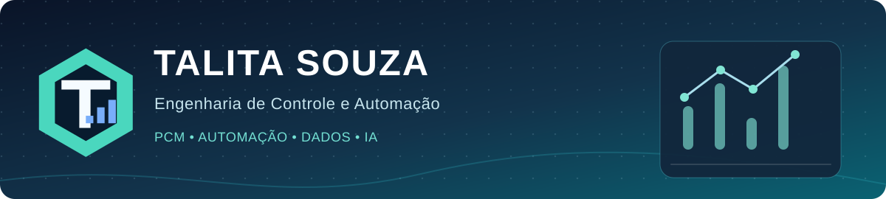

<!-- README do perfil: exibir na página github.com/talita-olv -->

  

  
  

## 👩‍💻 Sobre mim

Sou **Engenheira de Controle e Automação**, com pós-graduação em **Inteligência Artificial** e **Engenharia e Gerenciamento da Manutenção**. Atuo com **Planejamento e Controle de Manutenção (PCM)**, análise de dados, SAP e desenvolvimento de automações e soluções digitais.

Meu foco é conectar **engenharia, dados e tecnologia** para reduzir tarefas repetitivas, tornar processos mais confiáveis e apoiar decisões operacionais.

> **Um exemplo prático:** automatizei uma rotina de levantamento e tratamento de estratégias de manutenção no SAP, reduzindo uma atividade que ocupava uma manhã para aproximadamente **20 minutos**.

## 🚀 Projetos em destaque

| Projeto | Aplicação prática | Acessar |
| :--- | :--- | :--- |
| **Mapa de 52 Semanas** | Planejamento anual de manutenção, ciclos e estratégias, carga semanal e exportação de dados. | [Código](https://github.com/talita-olv/mapa-52-semanas) · [Demo](https://talita-olv.github.io/mapa-52-semanas/) |
| **SmartRoute** | Roteirização e programação de atendimentos por equipe, prioridade e localização, com mapa interativo. | [Código](https://github.com/talita-olv/smart-route) · [Demo](https://talita-olv.github.io/smart-route/) |

**Outras frentes de atuação:** automação de extrações e rotinas SAP, painéis de indicadores em Power BI e soluções de análise para manutenção e operações. Alguns trabalhos utilizam dados e integrações não públicos.

## 🛠️ Tecnologias e ferramentas

**Gestão, indicadores e automação**

**Dados e desenvolvimento de soluções**

## 📊 Atividade no GitHub

  
  

Os gráficos acima são produzidos por um serviço externo e podem ficar indisponíveis temporariamente. O ranking de linguagens considera repositórios analisados pelo GitHub, não o nível de domínio técnico.

---

  <b>Transformando desafios da engenharia em soluções digitais práticas.</b> 
  <a href="https://www.linkedin.com/in/talita-souza-136590122/">Vamos nos conectar no LinkedIn</a>

